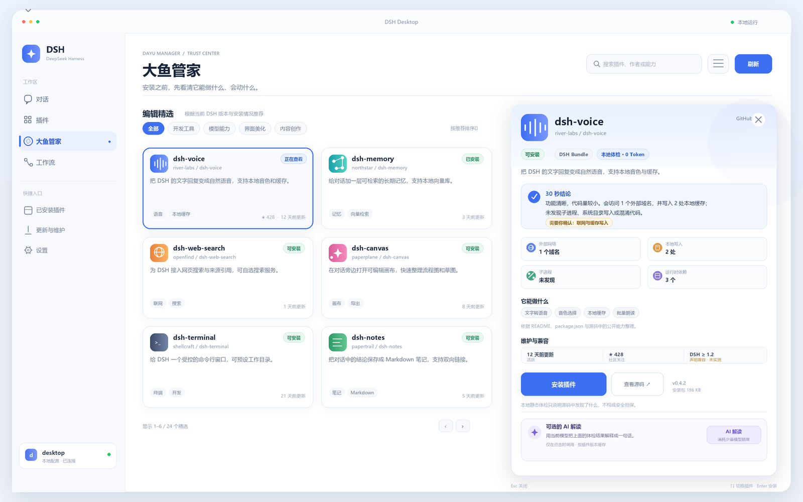

# 大鱼管家

> 安装之前，先看清它能做什么、会动什么。

大鱼管家是一个面向 DSH 的插件发现与安装决策面板。它把社区插件整理成可浏览的卡片，并在安装前用一份本地静态体检报告，帮你在 30 秒内判断：这个插件值不值得装、会带来哪些能力、有没有需要特别留意的行为。



## 它能做什么

### 精选插件，而不是搜索结果堆

- 按开发工具、模型能力、界面美化、内容创作、游戏开发等方向浏览。
- 支持关键词搜索、GitHub 令牌提高检索频率。
- 显示作者、简介、话题、Stars 和最近更新时间。
- 已安装插件会被标记，避免重复安装。

### 30 秒安装决策

选中一个插件后，右侧会集中展示：

- 它是做什么的
- 会访问哪些外部域名
- 会不会写入本地文件、写到什么范围
- 会不会启动子进程或执行命令
- 是否需要登录或填写 Key
- 运行时依赖数量
- 最近更新时间、分支和 Stars
- 完整静态检查明细

结论使用普通语言表达，不使用红黄绿灯作为安全承诺。

### 本地体检，0 Token

打开面板不会自动体检，也不会调用模型。

只有点击「开始本地体检」后，宿主才会只读下载并扫描插件源码。体检不会运行插件，也不消耗模型 Token。扫描内容包括：

- 模型接口与外部域名
- 登录、凭据与 Key 相关代码
- 本地文件写入与系统路径写入
- 子进程、Shell 调用
- 动态执行、混淆与超长编码载荷
- fork 状态、包来源与 npm 同名包情况

### 可选的 AI 解读

如果体检报告读起来仍然费劲，可以点击「AI 解读」。

- 只有点击时才调用模型
- 使用你当前 DSH 配置的默认模型和额度
- 只发送结构化体检事实，不发送插件源码
- 结果按插件与体检版本缓存，重复查看不会重复调用

## 安装

1. 打开 DSH 的插件页面。
2. 选择从 GitHub 安装插件。
3. 填入本仓库地址：`https://github.com/WOchovy233/dsh-dayu-manager`
4. 按 DSH 提示启用插件并刷新界面。

安装插件不需要本机安装 Git。插件会从 GitHub 的归档包安装。

## 隐私与边界

- 不包含遥测，不收集使用数据。
- GitHub 令牌只保存在本机浏览器，仅用于提高 GitHub API 频率上限。
- 本地体检不上传源码。
- AI 解读只发送体检事实，且必须由你主动点击。
- 静态体检是启发式判断，不能替代隔离运行，也不构成安全担保。
- 第三方插件与 DSH 拥有同等权限，请只安装你信任的项目。

## 使用限制

- 需要能够访问 `api.github.com`、`codeload.github.com` 与 `raw.githubusercontent.com`。
- 未登录的 GitHub 搜索有频率限制，可在面板中填入令牌提高上限。
- 只有声明了 DSH 插件清单的仓库才能被正确安装。
- 大型仓库的首次体检可能需要等待源码归档下载完成。

## 开发

```text
index.js    Host 路由、GitHub 检索、安装与 AI 解读
audit.js    源码归档解析与静态体检引擎
client.js   浏览器面板：列表、搜索、安装决策与体检展示
locale/     插件页面标题与描述
docs/       详情页与预览图
```

语法检查：

```powershell
node --check index.js
node --check audit.js
node --check client.js
```

## License

MIT